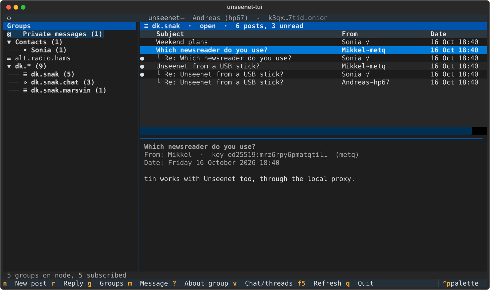

# First start

Get the client first: the [graphical client](../graphical.md) (portable,
bootable or in your browser) or the terminal client
([portable](../portable.md), [bootable](../bootable.md)). Then start it.

## What happens

There is no sign-up, no e-mail address and no phone number. The first
start makes three things on your own device:

1. **A vault** - one encrypted file that holds your keys and settings.
   Your **passphrase** opens it. Nobody else has a copy of the
   passphrase, so **it cannot be reset**: forget it and the vault stays
   locked for ever.
2. **An identity** - a key pair. The key *is* you: everything you write
   is signed with it, so nobody can post in your name. The display name
   you choose is only a label (see [Your key](your-key.md)).
3. **A first node** - the server your client talks to, over Tor. You can
   add more later (see [Nodes](nodes.md)).

=== "Graphical"

    1. **Choose a passphrase.** Long and easy for you to remember beats
       short and clever.
    2. **Choose a display name.** Right after, the client shows your 24
       **recovery words**. Write them on paper now, or choose *Later* - it
       reminds you, at most once a week. Already have an identity? Choose
       *Restore from recovery words* or *Get it from another device*
       instead (see [Backup and other devices](devices.md)).
    3. **Choose a node.** The client suggests one of the project's nodes at
       random, so not everyone starts on the same one, and keeps the others
       as backups. *Another node* takes an address you were given.

=== "Terminal"

    1. **Choose a passphrase.** The vault is `unseenet.vault` in the
       folder you start from (on a portable stick, in its `data/` folder).
    2. **Choose a display name.** The client shows your 24 **recovery
       words**; write them down and type three back, or do it later from
       the command palette (++ctrl+p++, *Show recovery words*).
    3. **Choose a node.** The first known node is suggested; *Also use the
       other known nodes as backups* (on by default) adds the rest.
       *Another node* takes an address you were given.

    

## The first minute

The first connection takes **10-30 seconds** while Tor builds its
circuits. After that you are in a handful of the project's groups - help,
news, a chat, a test group and the demo - so there is something to read
straight away. They are listed under
[The groups you start with](../help.md#the-groups-you-start-with), and you
can leave any of them.

You can **read at once**. Your **first post** waits until your new key has
ripened a little - about a quarter of an hour, once, while the client is
open. [Your key and ripening](your-key.md) explains why and where to see
how far it is.

!!! tip "Do this now"
    Write down your recovery words, or copy your vault somewhere safe. If
    you lose the vault and have neither, your identity is gone - there is
    nobody to ask. See [Backup and other devices](devices.md).

**More:** [Identity](../guide/identity.md) in *How it works*.
