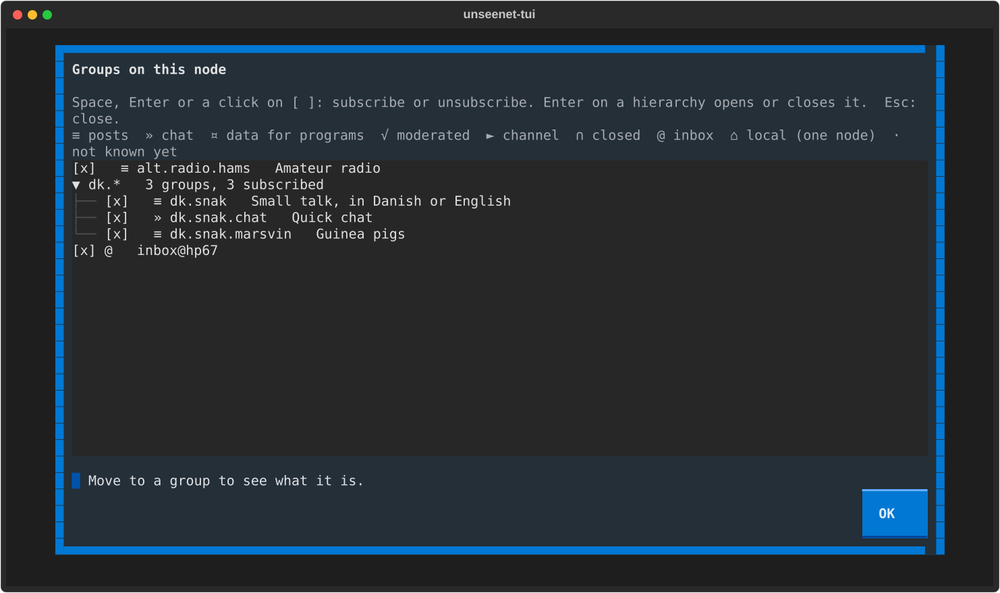

# Groups

Everything on Unseenet happens in a group: a discussion, a chat, a feed, a
site. A group has an **owner** - the key that made it - who decides who
may write and how it is shown. The network has no owner.

## Reading a group's name

Groups are named like the old Usenet: `dk.snak.marsvin` sits in the
**hierarchy** `dk`, the part before the first dot. A full group name ends
with `@` and the start of its owner's fingerprint - `dk.snak@abcd` - since
two people can make groups with the same name. The client leaves the
fingerprint out when the name cannot be mistaken, and shows it when it
can. In your own client, `unseenet.announce` without a fingerprint is the
one the project vouches for.

Each group has two small icons: who may write (none for an open group,
`√` moderated, `►` channel - only chosen people post, `∩` closed -
members only and encrypted), and how it is shown (`≡` threads, `»` chat).

## Finding and following groups

=== "Graphical"

    Press **G** (or ++ctrl+p++, *Find groups on your nodes*). Type to
    filter, and **Follow** a group to add it to your list - or **Leave**
    one you follow.

    

=== "Terminal"

    Press ++g++ to browse the groups on your nodes, by hierarchy. ++space++,
    ++enter++ or a click on `[ ]` follows a group or stops following it;
    the cursor on a line shows what the group is.

    

Someone gave you an address that starts with `unseenet:`, or wrote
`!dk.snak` in a post? **Open an unseenet: address** in the palette (++j++
in the terminal client), or press `!` on the post, to go there; for a
group you do not follow yet, the client shows what it is and asks first.

## What a group is about

Before you write, read its **charter**: the owner's few words on what the
group is for, its type, its owner and how long posts are kept.

=== "Graphical"

    The **?** button in the group's head (or ++question-mark++).

=== "Terminal"

    ++question-mark++ on the group.

A closed group (`∩`) can only be read by its members. To join one, give
the owner your key (see [Your key](your-key.md)); they invite you, and the
group turns up in your list.

## Discussion or chat

A group shows posts as **threads** - a tree you read one post at a time,
answered with a quote - or as a **chat**, lines in order with the newest
at the bottom. The owner chooses which a group is; ++v++ shows it the
other way for you, in both clients, without changing the group.

## Leaving a group

=== "Graphical"

    **Leave this group** in the palette, or **Leave** under *Find groups*.

=== "Terminal"

    **Unsubscribe from group** in the palette (++ctrl+p++), or ++g++ and
    ++space++ on it.

The group stays on the network; only your copy of its posts goes. A
starter group you leave is never added again.

**More:** [Groups](../guide/groups.md) in *How it works*, and how to make
your own group in [the graphical manual](../graphical.md) and
[the terminal manual](../client.md).
