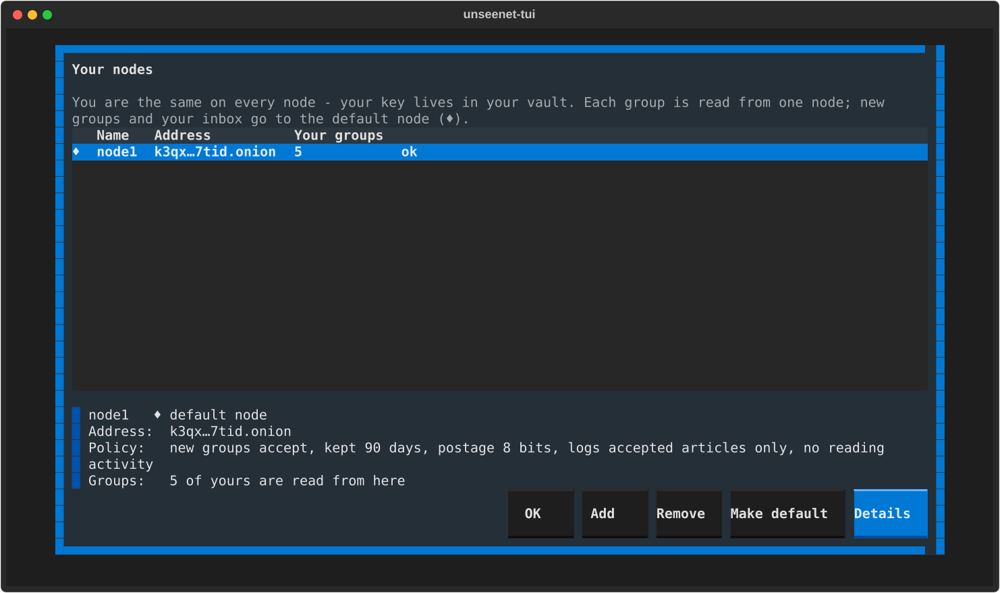

# Nodes

A **node** is a server that stores groups and passes posts on to other
nodes. Nodes are Tor onion services: nobody can see where they are, and
they never learn who you are. Anyone can run one.

Your key lives in your vault, not on a node, so you are the same person on
every node you use. One node may carry some groups and another node
others, so the client can use several at once: each group is read from
one of them, and if that node is down or stops carrying the group, the
client reads it from another.

Your **default** node (♦) is where new groups you make and your personal
inbox go.

=== "Graphical"

    Choose **Your nodes** in the palette (++ctrl+p++), or click a node's
    name where the client shows it. Each node shows its name,
    whether it answers and how many of your groups are read from it;
    **Details** says who runs it. **Add** takes an address you were given,
    **Make default** and **Remove** do what they say.

    

=== "Terminal"

    ++o++ for **Your nodes**: **Add** a node by its address (`xxxx.onion`),
    **Make default**, **Remove**, and **Details** for who runs it and a
    way to write to its operator.

    

Removing a node deletes nothing on it; the groups you read from it move to
your default node.

!!! note "Several nodes, one person"
    Using the same key on several nodes lets those nodes see it is the same
    person. That is fine for most people. If you want two parts of your life
    kept apart, use [two identities](your-key.md#several-identities).

**More:** [The node](../guide/node.md) in *How it works*, and
[Running a node](../node/install.md) if you want your own.
