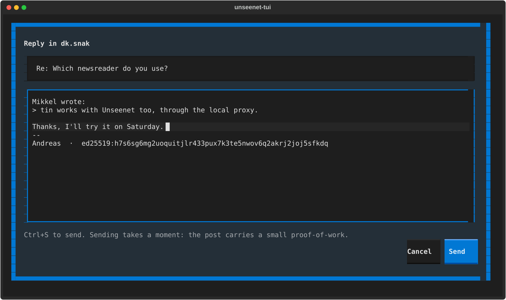

# Writing

## A post or a chat line

Unseenet has two kinds of message, and every message says which it is:

- a **post** has a subject, is read on its own and answered with a quote -
  for a discussion;
- a **chat line** has no subject and keeps a conversation going.

A group's owner decides which kinds a group takes. Where you may not
write - a channel only chosen people post in, a group you are banned from,
a closed group you are not in - the client says so before you start, not
after.

=== "Graphical"

    - **New post** (++n++) in the group's head opens the compose window:
      a subject, the text, your signature at the bottom, and *Post*
      (++ctrl+s++).
    - **Reply** (++r++) under a post opens the same window with the post
      quoted. Cut the quote down to what you answer.
    - In a chat, write in the line at the bottom and press ++enter++.

    

=== "Terminal"

    - ++n++ writes a new post, ++r++ replies to the selected one with a
      quote, and ++ctrl+s++ sends.
    - In a chat, the letters go into the input line and ++enter++ sends;
      ++escape++ gets you to the shortcuts again.

    

Sending takes a moment: every post carries a small **proof-of-work** - a
second or so of your computer's time - that makes mass spam expensive.
A new key also has to [ripen](your-key.md) once before its first post.

## Formatting, pictures and files

What you write is **Markdown**: `*emphasis*`, `**strong**`, lists, quotes,
links, tables and emoji (`:tada:` or 🎉). It reads fine unformatted too.
`#word` makes a tag, and `!dk.snak` points to a group.

Where a group takes them, posts and chat lines can carry **pictures and
small files** (such as PDFs). Pictures are saved again without their
hidden metadata - where and when they were taken, the camera.

=== "Graphical"

    **Add pictures or files** in the compose window, or paste or drop
    them there; **Add pictures** beside the chat line.

=== "Terminal"

    The command line attaches files: `unseenet post GROUP --attach FILE`.

## Reacting

Under a post, a comment or a chat line you can leave one **reaction** - an
emoji such as 👍 - instead of writing "+1". The same again takes it back.
Reactions are public, and you cannot react to your own.

=== "Graphical"

    The reaction button under the post.

=== "Terminal"

    ++l++, then the number of the emoji.

## Editing and withdrawing

You can **edit** your own posts, and **withdraw** them. A withdrawn post
is gone from the nodes and from other clients, but it is *withdrawn, not
deleted*: anyone who read it may have kept a copy. Think before you post.

=== "Graphical"

    The **⋯** menu on the post or chat line: *Edit*, *Withdraw (delete)*,
    *Pin* (in a group you run), *Copy address* and *Report*.

=== "Terminal"

    ++e++ edits your selected post or chat line, and ++shift+d++ withdraws
    it.

**More:** [Groups](../guide/groups.md) and
[A post's journey](../guide/journey.md) in *How it works*.
